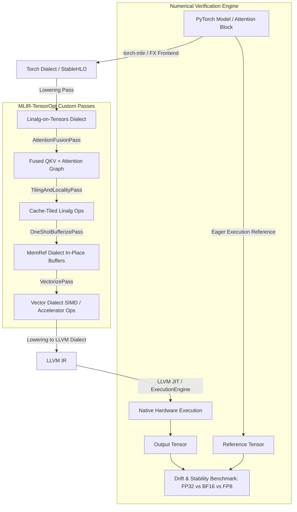

# MLIR-TensorOpt: Deep Learning Compiler & Lowering Pipeline

[](https://isocpp.org/)
[](https://pytorch.org/)
[](https://mlir.llvm.org/)
[]()

> An end-to-end MLIR (Multi-Level Intermediate Representation) compiler optimization and lowering pipeline that brings high-level PyTorch tensor operators (Multi-Head Attention, Batched GEMM, LayerNorm) down to efficient hardware execution through custom rewrite patterns, operator fusion passes, loop tiling, and numerical drift validation.

---

## 🎯 Executive Summary & Cerebras Systems Alignment

Modern AI accelerators (such as the **Cerebras Wafer-Scale Engine (WSE)**, Google TPU, and AMD CDNA) cannot execute high-level PyTorch code directly. Instead, they rely on specialized MLIR-based compiler stacks to:
1. Ingest PyTorch model graphs (`torch-mlir` / FX graph).
2. Lower high-level tensor operations into intermediate structured dialects (`linalg`, `tensor`).
3. Optimize execution schedules via **operator fusion**, **loop tiling for on-chip cache/SRAM locality**, and **in-place bufferization**.
4. Lower to hardware-specific execution forms while isolating **numerical divergence across FP32, BF16, and FP8** precision formats.

`MLIR-TensorOpt` demonstrates a complete, modular AI compiler pipeline implementing these exact industry-standard techniques.

---

## 🏛️ Compiler Pipeline Architecture



---

## 🚀 Key Technical Features

### 1. Custom Rewrite Patterns & Operator Fusion
- **Multi-Head Attention Fusion**: Fuses Linear QKV projection, scaling, attention masking, and softmax with batched matrix multiplication into a single fused execution subgraph, eliminating intermediate DRAM/SRAM memory roundtrips.
- **PatternRewriter Infrastructure**: Implemented via C++ MLIR `RewritePatternSet` and greedy pattern rewrites (`applyPatternsAndFoldGreedily`).

### 2. Hierarchical Loop Tiling for On-Chip Cache / SRAM Locality
- Parameterized loop tiling passes targeting L1/L2 cache and on-chip SRAM constraints.
- Employs `linalg.tile_to_forall` and `linalg.tile` to decompose large GEMM tensors into hardware-friendly micro-tiles, maximizing data reuse and instruction-level parallelism.

### 3. One-Shot Bufferization & Zero-Copy Memory Planning
- Eliminates intermediate tensor allocation overheads by converting value-semantic `tensor` operations to destination-passing, mutable `memref` operations in-place.
- Enforces strict alias analysis and buffer reuse to prevent memory bloat during multi-layer forward passes.

### 4. Vectorization & SIMD Mapping
- Lowers `linalg.generic` and structured operations down to the `vector` dialect with native 128-bit/256-bit SIMD vectorization (AVX2 / ARM NEON / Accelerator vector units).

### 5. Multi-Precision Numerical Correctness & Drift Verification
- Automated numerical divergence validation testing **FP32, BF16, and FP8** precisions against PyTorch eager ground-truth.
- Metrics computed: Root Mean Square Error (RMSE), Maximum Absolute Difference ($	ext{Max } |\Delta|$), Relative Error, and Cosine Similarity.
- Diagnostics suite to pinpoint which compiler lowering pass introduces numerical drift.

---

## 📂 Repository Structure

```
MLIR-TensorOpt/
├── README.md                      # High-level overview and quickstart
├── ARCHITECTURE_SPEC.md           # Exhaustive technical and dialect spec
├── IMPLEMENTATION_ROADMAP.md      # Step-by-step developer build guide
├── CEREBRAS_ALIGNMENT.md          # Alignment with Cerebras Systems MLE role
├── CMakeLists.txt                 # Top-level CMake configuration
├── include/
│   └── mlir_tensoropt/
│       ├── Dialect/               # Custom dialect definitions (if needed)
│       ├── Passes/                # C++ Pass headers
│       │   ├── AttentionFusion.h
│       │   ├── LoopTiling.h
│       │   └── Vectorization.h
│       └── Verification/          # Divergence checker headers
├── lib/
│   └── Passes/                    # Pass implementations in C++
│       ├── AttentionFusion.cpp
│       ├── LoopTiling.cpp
│       └── Vectorization.cpp
├── python/
│   ├── frontend/                  # PyTorch -> MLIR ingestion
│   │   ├── export_attention.py
│   │   └── export_mlp.py
│   ├── pipeline/                  # Python compiler pass orchestration
│   │   └── run_pipeline.py
│   └── benchmarks/                # Verification and benchmarking
│       ├── verify_numerical_drift.py
│       └── benchmark_latency.py
└── tests/
    ├── lit.site.cfg.py            # LIT test runner configuration
    ├── fusion_test.mlir           # FileCheck compiler tests
    └── tiling_test.mlir
```

---

## 🛠️ Prerequisites & Environment Setup

- **OS**: macOS / Linux (Ubuntu 22.04+)
- **Build System**: CMake 3.20+, Ninja, C++17/20 compiler (Clang 16+ or GCC 11+)
- **Python**: Python 3.10+
- **Key Packages**:
  - `torch >= 2.1.0`
  - `torch-mlir` (or prebuilt MLIR wheels via `pip install mlir-wheels` / LLVM MLIR build)
  - `numpy`, `tabulate`, `rich`
